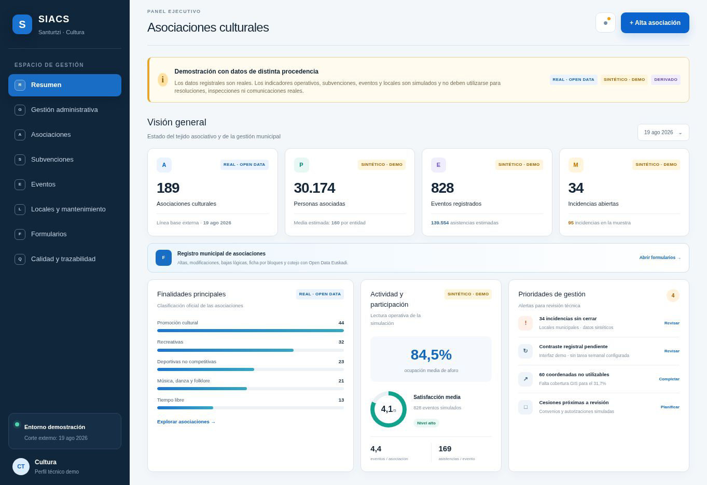
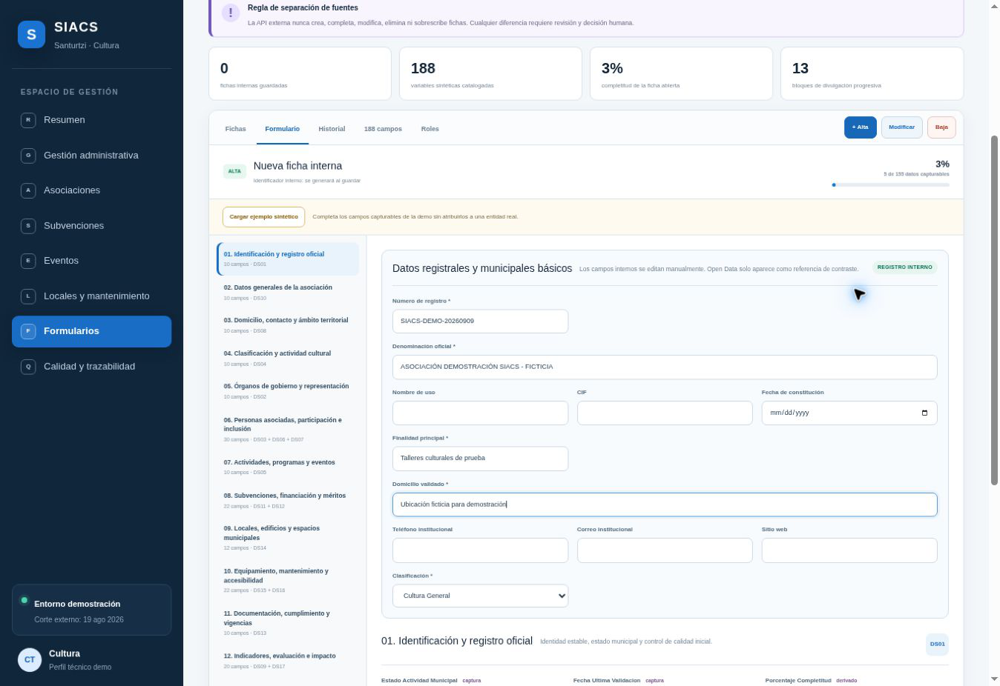
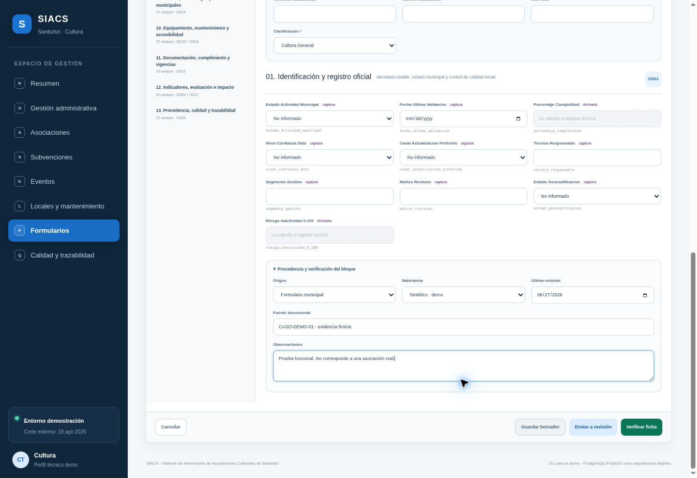
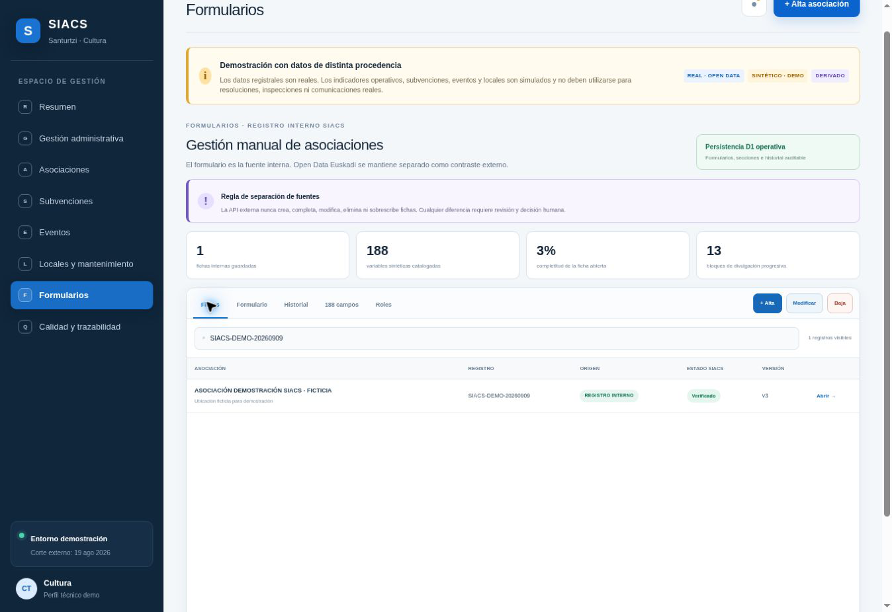
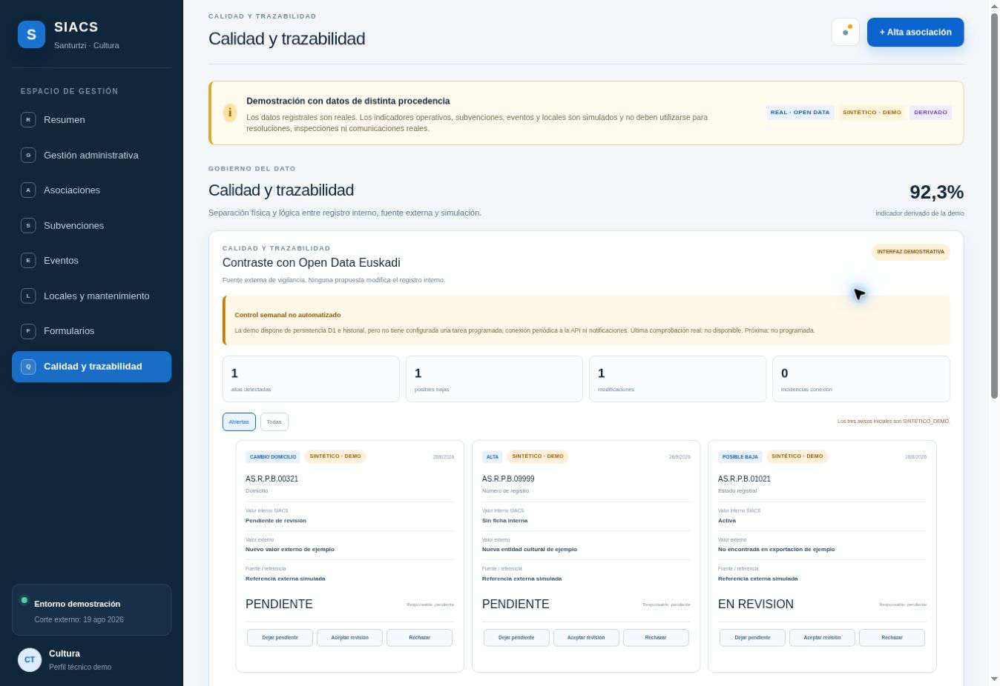

# SIACS · Sistema de Información de Asociaciones Culturales de Santurtzi

Diseño y desarrollo de una aplicación web MVP orientada a la digitalización, gestión y análisis de datos de las asociaciones culturales del municipio de Santurtzi (Bizkaia).

**Objetivo:** transformar información dispersa en conocimiento útil, mejorar la eficiencia administrativa y promover una gestión cultural basada en datos.

**Estado: MVP demostrador de portafolio. No es un sistema municipal implantado ni un registro oficial.**

## Problema y propuesta

La información registral externa no basta para conocer la actividad cultural local, mantener contactos actualizados o seguir actividades, subvenciones y espacios. SIACS plantea un registro interno con captura manual, revisión humana, procedencia e historial, acompañado de indicadores para apoyar la gestión.

El proyecto combina análisis de negocio, calidad del dato, diseño de procesos, modelado relacional y desarrollo web. La propuesta se ha documentado para valoración municipal; este repositorio no acredita aprobación, contratación ni implantación por el Ayuntamiento.

## Tres fuentes que deben mantenerse separadas

| Información | Uso |
|---|---|
| Registro interno | Datos introducidos y revisados manualmente por las personas autorizadas. |
| Open Data Euskadi | Referencia externa para contrastar información registral. No sobrescribe fichas internas. |
| Datos sintéticos | Simulación de actividad, subvenciones, incidencias e indicadores. No son resultados municipales. |

El archivo de referencia de agosto de 2026 contiene 354 registros de Santurtzi; 189 corresponden a las categorías «Cultura General» y «Cultural Específico». Es una selección de una instantánea, no un censo actual de actividad cultural. Véase [fuentes y calidad](docs/fuentes_y_calidad.md).

## Capturas del MVP

Capturas originales del recorrido local documentado el 09/09/2026, sobre la versión 6 del MVP (27/08/2026). El caso de formulario es ficticio. Se han extraído del documento de demostración, sin recrear pantallas.

### Panel ejecutivo



**189** corresponde a la selección registral externa. **30.174 personas, 828 eventos y 34 incidencias** son valores sintéticos. Las cifras operativas no describen resultados reales del municipio.

### Alta de una ficha interna



El catálogo del MVP organiza 188 variables en 13 bloques: 150 de captura, 34 derivadas y 4 de sistema. Catalogar una variable no significa que su cálculo esté implementado.

### Procedencia y revisión



«Verificado» es un estado del flujo de trabajo. No convierte un dato sintético en real ni certifica jurídicamente una entidad.

### Recuperación de la ficha



El recorrido documentó guardado y recuperación en un entorno local. La separación efectiva de funciones mediante permisos de servidor sigue pendiente.

### Contraste externo



Los avisos son simulados. No existe una tarea semanal ni notificaciones reales configuradas. [Detalle y límites de las capturas](screenshots/README.md).

## Qué existe y qué está propuesto

| Área | Estado documentado del MVP |
|---|---|
| Interfaz | React/TypeScript y Vinext. |
| Registro interno | API y persistencia D1/SQLite; cuatro tablas documentadas. |
| Alta, revisión e historial | Implementados; recorrido local documentado con datos ficticios. |
| Otros flujos administrativos | Operaciones demostrativas en localStorage. |
| Paneles operativos | Muestras y resúmenes demostrativos; las nuevas fichas no recalculan automáticamente los paneles. |
| Roles | Modelo documentado; autorización granular pendiente. |
| PostgreSQL/PostGIS | Arquitectura de evolución propuesta. |
| Automatización periódica, predicción e IA | No acreditadas como funciones operativas. |
| Implantación municipal | No acreditada. |

La referencia funcional procede de la memoria del 09/09/2026. Esta publicación no constituye una nueva auditoría del servicio alojado. [Arquitectura y límites](docs/arquitectura.md).

## Contenido de este repositorio

Este repositorio publica documentación, capturas y **ejemplos técnicos independientes creados para el portafolio**. No contiene el código completo de la aplicación web ni permite desplegarla. Los ejemplos Python/SQL no se presentan como el backend del MVP.

| Carpeta | Contenido |
|---|---|
| `docs/` | Arquitectura, modelo de ejemplo, metodología, KPIs y fuentes. |
| `data/` | Tres CSV con asociaciones, eventos y subvenciones completamente ficticios. |
| `sql/` | Esquema relacional de ejemplo, carga sintética y consultas de KPIs. |
| `src/` | Análisis reproducible en Python, sin dependencias externas. |
| `screenshots/` | Cinco capturas PNG reales del demostrador. |

### Ejecutar el ejemplo Python

Requiere Python 3.10 o posterior. Desde la carpeta del repositorio:

```bash
python src/ejemplo_analitica.py
```

En Spyder, abre ese archivo y ejecútalo. Las rutas se resuelven respecto al script, por lo que no necesitas cambiar el directorio de trabajo. El resultado se imprime en consola; no modifica los CSV ni se conecta al MVP.

### Explorar el ejemplo SQL

En una **base de datos vacía de pruebas**, ejecuta en este orden:

1. `sql/schema_demo.sql`
2. `sql/datos_demo.sql`
3. `sql/consultas_kpi.sql`

El SQL usa tipos y restricciones compatibles con PostgreSQL. No incluye credenciales, conexiones ni comandos de borrado. Es un modelo educativo reducido de tres entidades; no es una migración de D1 ni el modelo completo propuesto.

## Documentación

- [Arquitectura](docs/arquitectura.md)
- [Modelo de datos del ejemplo](docs/modelo_datos.md)
- [Metodología y evolución hacia un piloto](docs/metodologia.md)
- [Definiciones y resultados de KPIs](docs/kpis.md)
- [Fuentes y calidad del dato](docs/fuentes_y_calidad.md)
- [Diccionario de los CSV sintéticos](data/README.md)
- [Validación del ejemplo y límites de las pruebas](docs/validacion.md)

## Alcance público

Los CSV son totalmente sintéticos y no están vinculados a entidades reales. Las capturas combinan agregados de una fuente externa con simulaciones claramente indicadas. No se publica el Excel original, registros personales, expedientes municipales, credenciales ni la dirección del servicio alojado.

La documentación municipal completa y el vídeo permanecen fuera de este repositorio. No se añade una licencia en esta publicación inicial.
