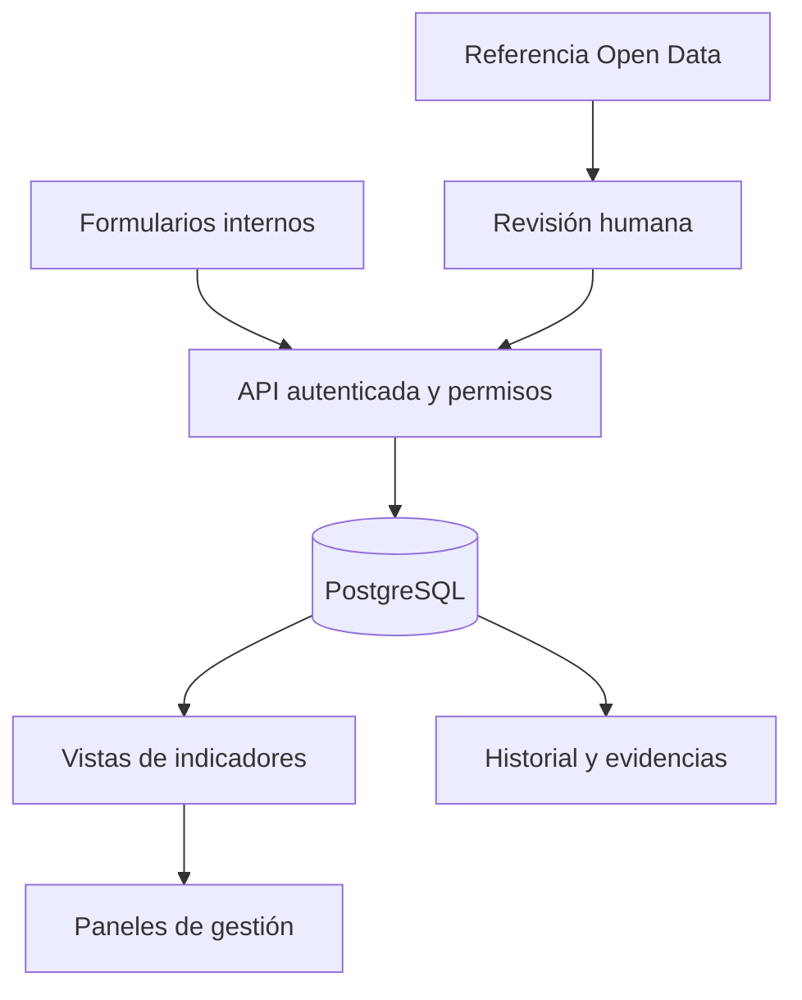

# Arquitectura y alcance

## MVP documentado

La memoria de 09/09/2026 revisó la versión 6, código fechado el 27/08/2026, referencia `bbb6ed7c0d1974241177aad1136e3f2443cda88a`.

- Interfaz: React/TypeScript y Vinext.
- API de asociaciones y API de alertas, con consulta y escritura en servidor.
- D1, basada en SQLite: asociaciones, secciones de ficha, alertas registrales e historial.
- Secciones almacenadas como JSON por asociación, sección y periodo.
- Flujos administrativos adicionales de demostración almacenados en localStorage.
- Matriz de cinco roles documentada, sin autorización granular completa en servidor.

El guardado y la recuperación de fichas se probaron localmente. La memoria confirmó la existencia de cuatro tablas en el alojamiento, pero no una prueba de escritura con datos reales en el sitio publicado. El historial no acredita inalterabilidad.

## Evolución propuesta

La fuente externa propone contrastes; una persona decide cualquier modificación interna. PostGIS solo se incorporaría si existen requisitos territoriales y geometrías validadas. BI, automatización e IA requieren datos y objetivos que justifiquen su uso.

El repositorio público contiene un ejemplo SQL/Python reducido y desconectado del MVP. No configura una infraestructura productiva.
